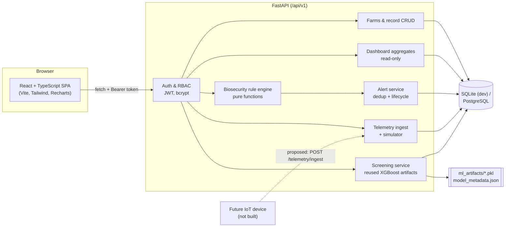

# Architecture

## System overview



* One frontend, one backend process. The original Flask model server is **not** run; its
  inference logic lives inside FastAPI as a service.
* SQLite needs no server for local development. The schema uses portable types, a
  naming convention and a partial unique index that work on both SQLite and PostgreSQL;
  the whole test suite was run against both (see `testing-log.md`).

## Backend layout (`backend/app`)

| Path | Responsibility |
|---|---|
| `main.py` | App factory, CORS (configured origins only), error handlers, startup (fails fast without `SECRET_KEY` in production, loads the model) |
| `core/config.py` | Environment settings (`.env`) |
| `core/security.py` | bcrypt hashing, JWT (HS256) creation/verification |
| `core/deps.py` | `get_current_user`, `require_roles`, farm scoping (`scope_farms`, `get_accessible_farm`) |
| `core/errors.py` | Uniform error body `{detail, code, errors[]}`; DB errors → 409/500 without leaking internals |
| `models/` | SQLAlchemy 2.x models |
| `schemas/` | Pydantic request/response models and validation rules |
| `api/v1/*` | Routers: `auth`, `users`, `farms`, `records` (generic factory for 5 record types + telemetry), `assessments` (+ alerts), `dashboard`, `screening`, `health` |
| `services/biosecurity/rules.py` | Pure rule engine: `FarmSnapshot → AssessmentResult` |
| `services/biosecurity/service.py` | Builds snapshots from the DB, persists assessments, synchronises alerts |
| `services/screening/model_service.py` | Loads/validates artifacts, predicts, annotates outputs |
| `services/telemetry.py` | Synthetic reading generator (`source=simulated`) |
| `services/audit.py` | Append-only audit log feeding "recent activity" |

## Authorisation model

Authorisation is enforced on the server for every request; the role is read from the
database on each request (a forged role claim in the token has no effect — tested).

| Capability | Admin | Veterinarian | Farmer |
|---|---|---|---|
| See farms | all | assigned (`veterinarian_id`) | owned (`owner_id`) |
| Register farm | yes (any owner/vet) | no | yes (owner = self, no vet) |
| Edit farm details | yes | assigned farms | own farms |
| Change owner / vet assignment | yes | no | no |
| Delete farm | yes | no | no |
| Add records | any farm | assigned farms | own farms |
| Edit / delete a record | any | records on assigned farms | records they entered |
| Run assessment | any farm (+ run-all) | assigned (+ run-all within scope) | own farms |
| Acknowledge alert | yes | assigned | own farms |
| Resolve alert (note required) | yes | assigned | **no** |
| Manage users | yes | no | no |
| Screening history | all | assigned farms + own requests | own farms + own requests |

Inaccessible farms, records and alerts return **404** (not 403) so identifiers cannot be
probed. Accounts are created by administrators; there is no public sign-up.

## Key design decisions

* **Assessments are explicit.** Alerts are created only by `POST /farms/{id}/assessments`
  (or the admin/vet run-all). Dashboards and lists are pure reads, so refreshing never
  creates alerts. Deduplication: one non-resolved alert per `farm_id:rule_code`, enforced
  in the service and by a partial unique index. Re-triggering updates `last_seen_at` and
  `occurrence_count`; after resolution a recurrence creates a new alert.
* **Insufficient data is a status, not a score.** See `model-limitations.md` and the rule
  table in `rules.py`.
* **Derived values are computed server-side** (hygiene pass/fail, visitor
  `precautions_complete`) so clients cannot submit inconsistent results.
* **Timestamps** are stored timezone-aware in UTC (`UTCDateTime` type; SQLite values are
  re-attached to UTC on read).
* **Token storage**: the SPA keeps the JWT in `sessionStorage` (cleared when the tab
  closes). An httpOnly cookie with CSRF protection would be stronger for production; noted
  as deferred.

## API

Interactive documentation: `http://localhost:8000/api/v1/docs` (OpenAPI JSON at
`/api/v1/openapi.json`). Main resources:

```
POST /auth/login            GET /auth/me
GET|POST /users             PATCH /users/{id}
GET|POST /farms             GET|PATCH|DELETE /farms/{id}
GET|POST /farms/{id}/{vaccinations|mortality|hygiene|visitors|environment}
GET|PUT|DELETE /farms/{id}/{kind}/{record_id}
POST /farms/{id}/environment/simulate     POST /telemetry/ingest
POST|GET /farms/{id}/assessments          GET /assessments/{id}    POST /assessments/run-all
GET /alerts   POST /alerts/{id}/acknowledge   POST /alerts/{id}/resolve
GET /dashboard/summary?date_from&date_to
GET /screening/status   POST|GET /screening   GET /screening/{id}
GET /health
```

## Frontend layout (`frontend/src`)

| Path | Responsibility |
|---|---|
| `api/client.ts` | `fetch` wrapper: token header, error parsing into `ApiError`, 401 → sign-out; never substitutes data on failure |
| `api/endpoints.ts`, `api/types.ts` | Typed API surface |
| `auth/AuthContext.tsx` | Session state; the user/role is always fetched from `/auth/me` |
| `components/ui.tsx` | Button, Card, StatusBadge, Spinner, ErrorState (with recovery hints), EmptyState, Modal, ConfirmDialog, Field, StatCard, Table, Pager, SuccessToast |
| `components/charts.tsx` | Recharts wrappers with a table-view toggle and a validated categorical palette |
| `components/FarmForm.tsx`, `RecordForms.tsx` | React Hook Form + Zod forms mirroring backend validation; server field errors are mapped back to inputs |
| `pages/*` | Login, role-specific Dashboard, Farms, Farm detail (records tabs, assessments, environment, screening history), Alerts, Screening, IoT concept, Users (admin), About |

## Testing strategy
* **Backend (pytest)**: migrations are applied by the test fixture; unit tests for the
  pure rule engine; API tests for CRUD, validation, RBAC/ownership, alerts, telemetry,
  dashboard and the real model artifacts.
* **Frontend (Vitest + Testing Library)**: API client error handling, UI states, login validation.
* **End-to-end (Playwright, `e2e/journey.mjs`)**: the 12-step user journey against running services.
* **Static checks**: `ruff`, `tsc`, ESLint, production build.
