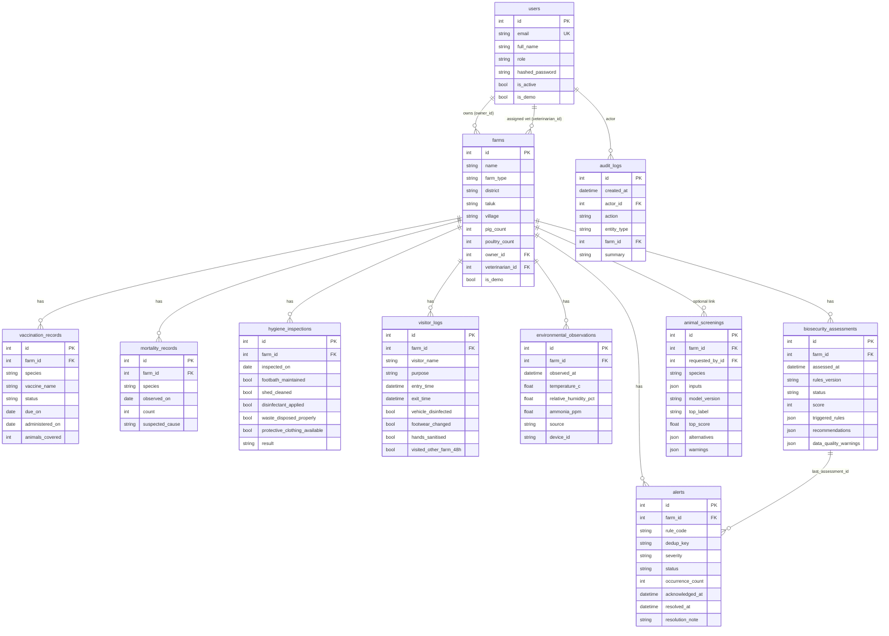

# Database schema

Managed by Alembic (`backend/alembic/versions/0001_initial_schema.py`). Default database:
SQLite file `backend/triveni_kavach.db`; PostgreSQL is supported via `DATABASE_URL`.
Enumerations are stored as short strings (non-native enums) for portability.



## Tables

| Table | Notes and constraints |
|---|---|
| `users` | `email` unique; `role` ∈ admin / veterinarian / farmer; bcrypt hash only; `is_demo` marks seeded fictional accounts |
| `farms` | `farm_type` ∈ pig / poultry / mixed; counts ≥ 0 (CHECK); API also rejects pigs on poultry farms and vice versa; location is district/taluk/village — **no coordinates**; `owner_id`, `veterinarian_id` → users (SET NULL) |
| `vaccination_records` | `status` ∈ scheduled / completed / missed; CHECK at least one of `due_on`, `administered_on`; API: completed needs `administered_on` (not future), scheduled/missed need `due_on` |
| `mortality_records` | `count` ≥ 0; **0 = explicit nil report** (lets the engine distinguish "no deaths" from "not reported") |
| `hygiene_inspections` | five checklist booleans; `result` derived server-side (pass only if all true) |
| `visitor_logs` | precautions; `precautions_complete` derived; exit ≥ entry |
| `environmental_observations` | at least one value; physical-plausibility bounds; **`source` ∈ manual / simulated / device** (device rejected unless enabled); composite index (farm_id, observed_at) |
| `biosecurity_assessments` | immutable history; JSON lists of triggered rules, observations, recommendations, warnings, limitations; `score` NULL when status is `insufficient_data` |
| `alerts` | `dedup_key = "<farm_id>:<rule_code>"`; **partial unique index** on `dedup_key WHERE status != 'resolved'`; acknowledgement/resolution actor + timestamps; note required to resolve |
| `animal_screenings` | inputs, model version (artifact hash), raw top/alternative scores, whether the top label was observed for the species in training, warnings |
| `audit_logs` | actor, action, entity, farm, summary — no passwords or tokens |
| `outbreak_notices` (migration 0002) | official notices: disease, species (pig/poultry/both), state/district/taluk, reported/closed dates, status; **`source_name` and `source_url` mandatory** |
| `livestock_statistics` (migration 0002) | district population per species and reference year with source name/URL and `import_method` (manual / csv / data.gov.in); unique per state+district+species+year+source |

All farm-scoped tables cascade on farm deletion (administrator-only, with a confirmation
dialog in the UI). All timestamps are timezone-aware UTC; `created_at`/`updated_at` exist on
users, farms, records and alerts.

## Migration commands
```powershell
cd backend
alembic upgrade head      # create / upgrade
alembic downgrade base    # drop everything
alembic check             # verify models and migrations agree
```
