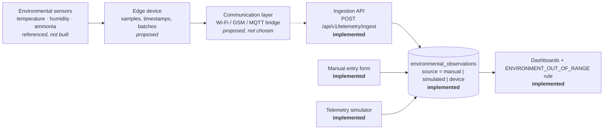

# IoT concept (software-only)

**No physical hardware was built, installed or tested in this internship.** The IoT layer
is a documented concept plus a working software path for readings that are entered
manually or generated by a simulator.

## What the reference material confirms

| Item | Evidence | Status |
|---|---|---|
| Environmental monitoring of temperature, humidity and air quality | SIH-25006 `FeaturesSection.tsx`: "IoT Integration — real-time environmental monitoring with temperature, humidity, and air quality sensors"; `StatsSection.tsx`: "IoT Sensor Network" | Mentioned as an intended feature only |
| Temperature/humidity values in the farmer app | `FarmerMobileApp.tsx` uses fixed `useState(24)` and `useState(65)`; the HTML farmer app has a static "shed temperature slightly high" alert | Hard-coded, not sensor data |
| Specific hardware (board, sensor models, radio, power) | The IoT reference image and the SIH presentation were **not available** in any supplied repository or its history | **Cannot be confirmed** |

Because the sample image could not be inspected, this document does **not** name any
microcontroller, sensor part number or communication module as "shown". Everything
upstream of the ingestion API below is a proposal.

## Conceptual flow



## Implemented in software

* **Manual form** (farm → Environment → Add reading) — always stored as `source=manual`.
  The endpoint rejects any other source.
* **Simulator** (`POST /farms/{id}/environment/simulate`, "Simulate telemetry" button) —
  diurnal sine pattern + noise, optional out-of-range excursion, stored as
  `source=simulated` with the note "Synthetic value … not a measurement". Disable with
  `ENABLE_TELEMETRY_SIMULATOR=false`.
* **Ingestion API** (`POST /telemetry/ingest`) — validated batch contract (1–500 readings,
  plausibility bounds, at least one value, no future timestamps). Accepts `manual` and
  `simulated`; `device` is rejected with HTTP 422 unless `ALLOW_DEVICE_SOURCE=true`.
* **Labelling**: every chart and table shows the source badge; the farm environment panel
  warns when a period contains simulated values; the assessment adds a data-quality warning
  when simulated readings were evaluated.

## Proposed future device contract

```http
POST /api/v1/telemetry/ingest
Content-Type: application/json
Authorization: <device credential — see open items>

{
  "farm_id": 3,
  "readings": [
    {
      "observed_at": "2026-10-25T06:00:00Z",
      "shed_label": "Shed 1",
      "temperature_c": 27.4,
      "relative_humidity_pct": 66.0,
      "ammonia_ppm": 11.5,
      "source": "device",
      "device_id": "haveri-farm3-shed1"
    }
  ]
}
```

Rules for a device: UTC ISO-8601 timestamps from a synchronised clock; batch and retry with
idempotent timestamps; send nulls for absent sensors; values outside plausibility bounds are
rejected (422) rather than clipped.

### Open items before enabling `device`
1. Per-device credentials (API key or mutual TLS) bound to one farm, instead of user JWTs.
2. Idempotency (unique `(device_id, observed_at)`), rate limiting, and clock-skew checks.
3. Sensor calibration records and maintenance status.
4. Choice of hardware and connectivity after field review (power, network coverage in
   Haveri taluks, enclosure for ammonia-rich sheds).
5. If MQTT is chosen, a bridge service that validates messages and calls the same
   ingestion contract — the broker would be optional infrastructure, not a requirement for
   running the application.
6. Expert review of operating ranges by species and age (current thresholds in
   `rules.py` are provisional placeholders).
